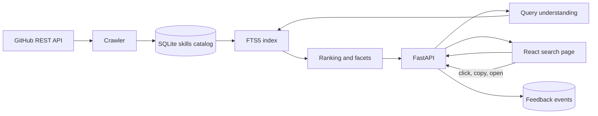

# SkillFinder

SkillFinder is a local search engine for AI agent skills and instruction files. GitHub is the catalog's source, but interactive searches run against SkillFinder's own SQLite database and FTS5 index. Search requests do not query GitHub.

## Features

- GitHub crawler for skill repositories, `SKILL.md`, and `AGENTS.md` files.
- SQLite catalog with an FTS5 full-text index and feedback events.
- Query normalization, typo correction, editable synonyms, category and agent detection.
- Configurable ranking with match explanations and agent, category, star, and update facets.
- FastAPI search, autocomplete, feedback, catalog status, and crawl endpoints.
- Responsive React search UI with autocomplete, filters, sorting, pagination, loading and empty states.

## Architecture and workflow



1. The crawler searches the configured GitHub topics and code for `SKILL.md` and `AGENTS.md`, fetches repository metadata and file contents, infers an agent and category, and upserts each skill record.
2. SQLite stores skills and feedback. The crawler rebuilds the FTS5 index after a successful run.
3. A user's query is normalized, typo-corrected, expanded with `backend/app/config/synonyms.json`, and mapped to categories using `categories.json`.
4. The search service retrieves up to 300 FTS5 candidates, ranks them using `ranking_config.json`, and returns up to 20 results with match explanations and filter facets.
5. The React client calls the local API for search and autocomplete. Click, GitHub-open, and install-path-copy actions send feedback to the API.

## Requirements

- Python 3.11 or newer, with SQLite FTS5 enabled.
- Node.js and npm.
- A GitHub personal access token for crawling. It is not needed to search the local catalog.

## Setup

### Backend

From the project root in PowerShell:

```powershell
cd backend
python -m venv .venv
.\.venv\Scripts\Activate.ps1
python -m pip install --upgrade pip
pip install -r requirements.txt
Copy-Item .env.example .env
```

Add your GitHub token to `backend/.env`:

```dotenv
GITHUB_TOKEN=your_github_token
```

Keep `.env` private and do not commit it. The crawler reads `GITHUB_TOKEN` from the process environment or `.env`. Searches use the catalog without this token. The default SQLite database is `backend/skillfinder.db`; set `SKILLFINDER_DB_PATH` to use another file.

Start the API from the `backend` directory:

<!-- ```powershell
$env:PYTHONPATH = "."
python -m uvicorn app.main:app --host 127.0.0.1 --port 8000 --reload
``` -->
```powershell
cd "C:\Users\Tanmoy Dutta\OneDrive\Desktop\DATA_SCIENCE\project1\backend"
.\venv\Scripts\Activate.ps1
uvicorn app.main:app --reload --port 8000
```
The API docs are at `http://127.0.0.1:8000/docs`; health is at `http://127.0.0.1:8000/health`.

### Frontend

Open a second terminal at the project root:

<!-- ```powershell
cd frontend
npm install
npm run dev
``` -->
```powershell
cd "C:\Users\Tanmoy Dutta\OneDrive\Desktop\DATA_SCIENCE\project1\frontend"
npm run dev
```

Open `http://localhost:5173`. Vite proxies `/api` requests to `http://127.0.0.1:8000`.

## Using SkillFinder

1. Start the backend and frontend.
2. Populate the catalog with the crawler (see below) if it is empty or needs refreshing.
3. Enter a query such as `video generation`, `pdf`, or `react testing`.
4. Choose filters for agent, category, minimum stars, or last-updated date. Change sorting to relevance, stars, or newest; use pagination to browse more results.
5. Use autocomplete suggestions to complete a skill name or tag. A result card explains why it matched and provides GitHub and install-path actions.

The UI sends `click`, `open`, and `copy` events to the feedback endpoint. Feedback is stored locally and contributes to ranking popularity.

## Crawl and schedule the catalog

Run from `backend` with the virtual environment active and a token configured:

```powershell
python crawler.py run
```

By default, the crawler searches `topic:claude-skills`, `topic:agent-skills`, `topic:codex`, and `topic:antigravity`, plus code searches for `filename:SKILL.md` and `filename:AGENTS.md`. Topic searches inspect up to 50 repositories each. GitHub search is limited to 10 pages per query (up to 1,000 search results). To seed a smaller sample:

```powershell
python crawler.py run --max-pages 1 --topic-repos 5
```

The crawler checkpoints progress by run ID, source, query, and page. Re-running with the same run ID resumes incomplete pages. Use an explicit ID to resume a named run later, or `--fresh` to clear that ID's checkpoints:

```powershell
python crawler.py run --run-id nightly-2026-11-19
python crawler.py run --run-id nightly-2026-11-19
python crawler.py run --run-id nightly-2026-11-19 --fresh
```

Transient errors and rate limits use `Retry-After`/reset-aware backoff. A nightly loop can run at a UTC time (default 02:00):

```powershell
python crawler.py schedule --at 02:00
```

For a managed Windows schedule, configure Task Scheduler to run `python crawler.py run` daily from the `backend` working directory. The crawler is also available through `POST /api/catalog/crawl?max_pages=10`; check its status at `GET /api/catalog/status`.

## API

| Method | Endpoint | Purpose |
|---|---|---|
| `GET` | `/health` | Health check |
| `GET` | `/api/agents` | Supported agents and install hints |
| `GET` | `/api/search?q=pdf&agent=all` | Search the local catalog |
| `GET` | `/api/suggest?q=rea` | Autocomplete skill names and tags |
| `POST` | `/api/feedback` | Record a `click`, `copy`, or `open` event |
| `GET` | `/api/catalog/status` | Catalog counts and last crawl status |
| `POST` | `/api/catalog/crawl?max_pages=10` | Start a background crawl |

Search accepts `agent`, `category`, `min_stars`, `updated`, `sort`, `page`, and `per_page` parameters. `agent` defaults to `all`; supported sort values are `relevance`, `stars`, and `recent` (the UI labels `recent` as “Newest”). `updated` accepts `30d`, `1y`, `2y`, `older`, or `unknown`.

Example:

```text
GET /api/search?q=react%20testing&agent=all&category=testing&min_stars=10&updated=1y&sort=relevance&page=1&per_page=20
```

Feedback JSON:

```json
{
  "skill_id": 123,
  "query": "pdf",
  "action": "copy"
}
```

## Ranking and query configuration

- `backend/app/config/synonyms.json`: query synonym expansions.
- `backend/app/config/categories.json`: category keyword map.
- `backend/app/config/ranking_config.json`: scoring weights, field weights, normalization, penalties, candidate/result limits, and star facets.

The current top-level ranking weights sum to 1.0. Text relevance is weighted above agent/category match, stars, recency, and feedback. Archived and stale repositories receive the configured penalties. Adjust configuration and rerun the query checks below when tuning search behavior.

## Tests and results

Run from the `backend` directory with the project virtual environment active:

```powershell
$env:PYTHONPATH = "."
python -m unittest discover -s tests -v
python tests/test_api.py
python tests/test_routes_direct.py
python tests/test_backend.py
python tests/test_github_search.py
```

The unittest discovery command runs the `unittest.TestCase` cases. The other files are standalone checks and should be run separately as listed.

| Test file | Cases | Result |
|---|---:|---|
| `test_query_understanding.py` | 6 | **6 passed**: typo/stopword cleanup, synonym expansion, category and agent detection, empty normalized query, FTS query construction |
| `test_search_endpoint.py` | 5 | **5 passed**: successful query, pagination arguments, invalid agent, empty query, catalog error handling |
| `test_api.py` | 3 checks | **Passed**: health response, agent list, invalid-agent HTTP 400 |
| `test_routes_direct.py` | 2 checks | **Passed**: direct agent retrieval and rejection of unsupported agent |
| `test_backend.py` | 2 checks | **Passed**: agent configuration fields and GitHub query builders |
| `test_github_search.py` | 4 checks | **Passed**: config loading, keyword scoring, cache TTL, timestamp parsing |
| `frontend` production build | TypeScript + Vite build | **Passed**: 1,584 modules transformed |

The unit tests were updated to match the current synonym map, search endpoint parameters, and route name. The combined test results are **22 checks passed** (11 unittest cases and 11 standalone checks).

### Local catalog search smoke cases

These queries were run against the seeded SQLite/FTS5 catalog after ranking tuning:

| Query | Results | Top result | Result |
|---|---:|---|---|
| `video generation skill for ai tool` | 15 | `video-shotcraft` | Relevant video-generation skill ranked first |
| `pdf` | 28 | `Skill_Seekers` | PDF-related skill ranked first |
| `react testing` | 56 | `ghost-qa` | React/testing match ranked first |
| `qzxv blorpt nonsense` | 0 | — | Empty result set as expected |

For a detailed ranking breakdown, each API result includes `score`, `score_breakdown`, `penalties`, and `why_matched`.

## Database and migration notes

The SQLite schema and FTS5 definition are in `backend/app/schema.sql`. SQLite FTS5 must be enabled in the Python SQLite build. Searches use the local index; only the crawler calls GitHub. A future PostgreSQL migration can replace the catalog storage and FTS retrieval while preserving the API response contract.
